# Cambodia Food Price Analysis and 3-Month Forecast (Oct – Dec 2026)

**Course:** Time-Series Data Analysis (Lecturer: KANN Bonpagna)
**Dataset:** WFP Food Prices – Cambodia (`wfp_food_prices_khm.csv`)
**Code:** `analysis.py` (fully reproducible; generates every figure in `figures/` and every table in `outputs/`)

---

## Executive summary

| Question | Answer |
|---|---|
| What do we forecast? | Monthly food prices (KHR) at national and province level |
| Main target series | Wholesale price of *Rice (mixed, low quality)*, KHR/kg, Jan 2003 – Sep 2026 (285 months) |
| Forecast horizon | **3 months: Oct, Nov, Dec 2026** |
| Best approach (rolling backtest) | Ensemble of Naive + damped Holt (ETS) + SARIMA(1,1,0); **MAPE ≈ 2.8% (1 month ahead) → 5.3% (3 months ahead)** |
| National rice wholesale forecast | **Oct 1,909 · Nov 1,915 · Dec 1,919 KHR/kg** (80% interval for Dec: 1,712 – 2,151) |
| Main finding | Rice prices behave **almost like a random walk** with short-term momentum (AR(1) on changes) and a **weak-to-moderate seasonal cycle (±4%)**. The best forecast is "about the same as now, slightly higher," with uncertainty that widens every month. |
| Retail outlook to Dec 2026 | Rice flat (~2,000), pork −4%, snakehead fish −11%, duck eggs −2%, oil and salt flat, wax gourd +14%; food-basket index expected to ease from 116 to ~106 |

---

## 1. Business goal (Step 1–3 of the forecasting process, EP1)

Food is the largest share of spending for poor Cambodian households, and rice is the staple. A 3-month price outlook helps:

* **Households / NGOs (e.g., WFP cash transfers):** set the value of cash assistance so it still buys the same food basket.
* **Government / Ministry of Commerce:** see price spikes coming and plan rice reserves or market interventions.
* **Traders and farmers:** decide when to sell or store paddy rice.

**Target variable:** monthly national median price (KHR) of each commodity.
**Forecast horizon:** 3 months, because it matches a quarterly planning and budgeting cycle (EP3: "3–12 months, monthly budget planning").
**Forecast origin:** the last month in the data, September 2026, so we forecast October, November and December 2026.

---

## 2. Data description (Step 4: gather historical data)

| Item | Value |
|---|---|
| Rows | 91,682 price records |
| Period | 2003-01-15 → 2026-09-15 (always recorded on the 15th, so the data is **monthly**) |
| Geography | 25 provinces (`admin1`), 86 markets |
| Commodities | 50 commodities in 8 categories (vegetables & fruits, meat/fish/eggs, cereals, oil, pulses, dairy, misc., wage) |
| Price types | Retail (46,326) and Wholesale (45,356), all in **KHR** (a USD column also exists) |

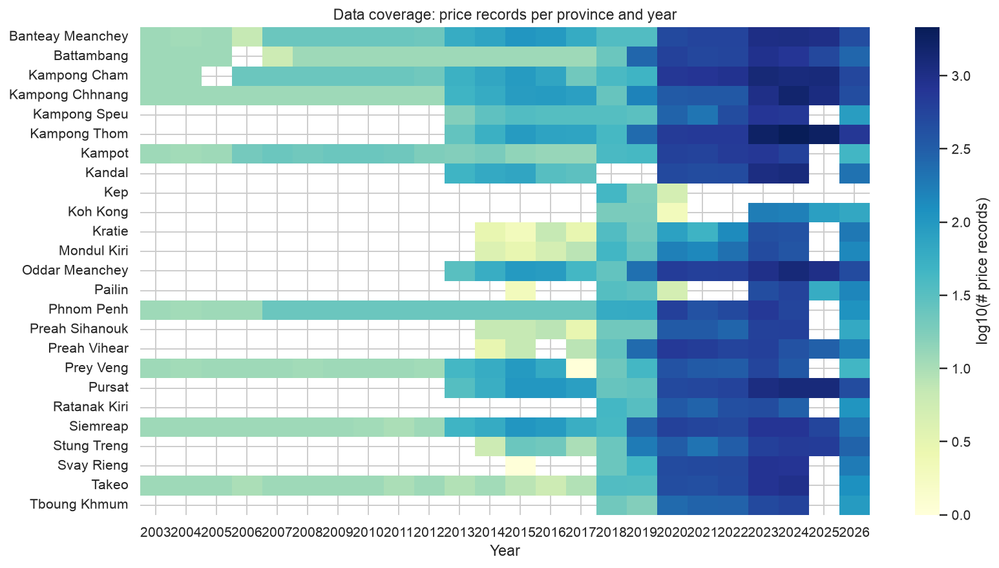

**Interpretation.** The dataset is **not** uniform over time:

* 2003–2012: only ~9 provinces, and almost only rice.
* 2013–2019: more provinces and commodities.
* 2020 onward: dense collection (~10,000–19,000 records per year).
* Some months are **completely missing nationwide**: Jan–Feb 2025, Apr–May 2026, Jul–Aug 2026.

### Data preparation decisions

1. **Province price = median across markets** in that province and month. Many provinces have several markets, and the median is robust to a single strange market (EP2: the mean is sensitive to outliers).
2. **National price = median across provinces.** Using the median stops the national level from jumping when a province enters or leaves the sample.
3. **Missing months were filled by linear interpolation** so the series is equally spaced, which time-series models require (EP1). Interpolated months are **flagged** and **never used to score forecasts**.
4. Each commodity is filtered on a single unit (e.g., vegetable oil uses only the "5 L" bottle), so prices are comparable.
5. For the 8-item retail basket we start in **Aug 2019**, when every item is collected continuously.

---

## 3. Exploratory analysis (Step 5: explore the pattern, EP1 + EP2)

### 3.1 Time plot

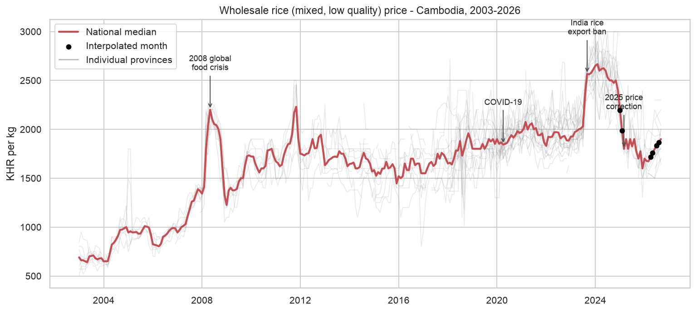

* **Trend:** prices rose from ~650 KHR/kg (2003) to ~1,700 (2010), were roughly flat at 1,500–2,000 for 2010–2022, then jumped to a record **2,667 KHR/kg in Feb 2024**.
* **Shocks:**
  * **2008 global food crisis:** 1,342 in Jan 2008 to 2,200 in May 2008 (+64% in 4 months).
  * **2023 shock:** a rise from mid-2023, which coincides with India's ban on non-basmati white rice exports (Jul 2023).
  * **2025 correction:** the price fell from ~2,500 (late 2024) to ~1,800 (2025), averaging 1,846 in 2025 vs 2,555 in 2024 (−28%).
* **Provinces (grey lines)** move together around the national line, so a national model plus province adjustments is reasonable (Section 7).

### 3.2 Measures of central tendency and histograms

| Series | Mean | Median | Mode (bin) | Std | Skew |
|---|---|---|---|---|---|
| Price level 2003–2026 (KHR/kg) | 1,630 | 1,702 | ~1,704 | 453 | −0.40 |
| Price level 2019–2026 | 2,011 | 1,925 | ~1,947 | 274 | +1.27 |
| Monthly % change | +0.46% | +0.39% | ~0% | 4.62% | +0.51 (kurtosis 5.65) |

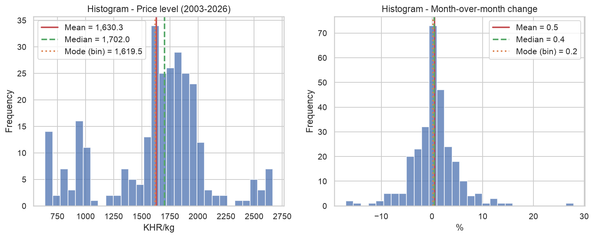

* The **level histogram** is spread out and slightly **bimodal**: one cluster around 700–1,000 (2003–2007) and one around 1,500–2,000. This is a sign of a changing mean, i.e. **non-stationarity** (Section 4).
* Since 2019 the mean (2,011) is above the median (1,925): the 2023–24 spike creates a **right skew**, a case where the median is the better "typical" value (EP2, House-prices example).
* **Monthly changes** are centred near 0% but have **fat tails** (kurtosis 5.6). Most months move ±2%, but rare months move +28% or −17%. Shocks matter more than normal fluctuations.

### 3.3 Boxplots: seasonality and provinces

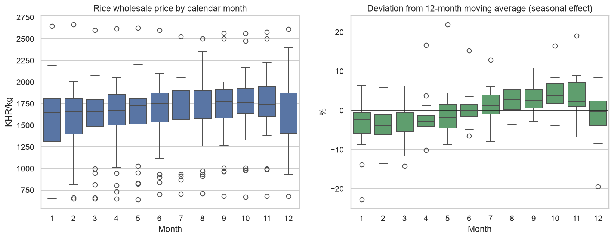

* **Left (raw prices by month):** the boxes look almost identical because the long-term trend hides the seasonal effect.
* **Right (deviation from the 12-month moving average):** removing the trend reveals a clear **seasonal pattern**:
  * **Lowest in Jan–Apr** (−3% to −4%), right after the main wet-season harvest (Nov–Jan) floods the market with paddy.
  * **Highest in Aug–Nov** (+3% to +4%), the "lean season" before the new harvest.
  * The outliers (e.g., +22% in May, −23% in Jan) are the 2008 crisis months. As EP2 notes, *an outlier is not automatically an error*; it is an event.

Seasonal index from the classical multiplicative decomposition (`outputs/03_seasonal_index.csv`):

| Jan | Feb | Mar | Apr | May | Jun | Jul | Aug | Sep | Oct | Nov | Dec |
|---|---|---|---|---|---|---|---|---|---|---|---|
| −3.9% | −3.9% | −3.3% | −2.1% | −0.9% | +0.1% | +1.4% | +2.7% | +3.1% | **+4.1%** | +3.9% | −1.1% |

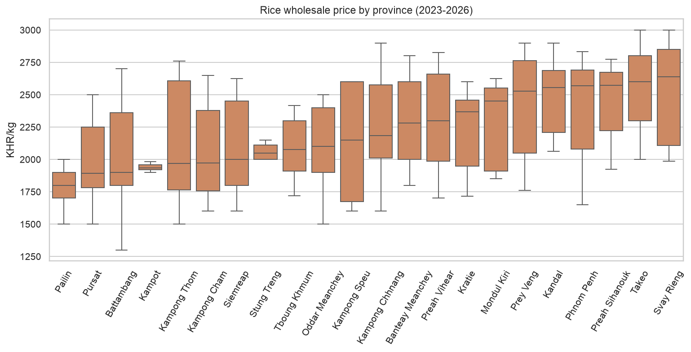

For 2023–2026, the lowest medians are in **Pailin, Pursat and Battambang** in the north-west rice belt. The highest are in **Svay Rieng, Takeo, Preah Sihanouk, Phnom Penh and Kandal** in the south and south-east: urban, coastal or border provinces.

*Caution:* provinces did not report in the same months. For example, a province that reported mostly in cheap 2025 looks artificially low. Section 7 corrects for this by comparing each province with the national price **in the same month**.

### 3.4 Decomposition (Trend + Seasonality + Residuals, EP1)

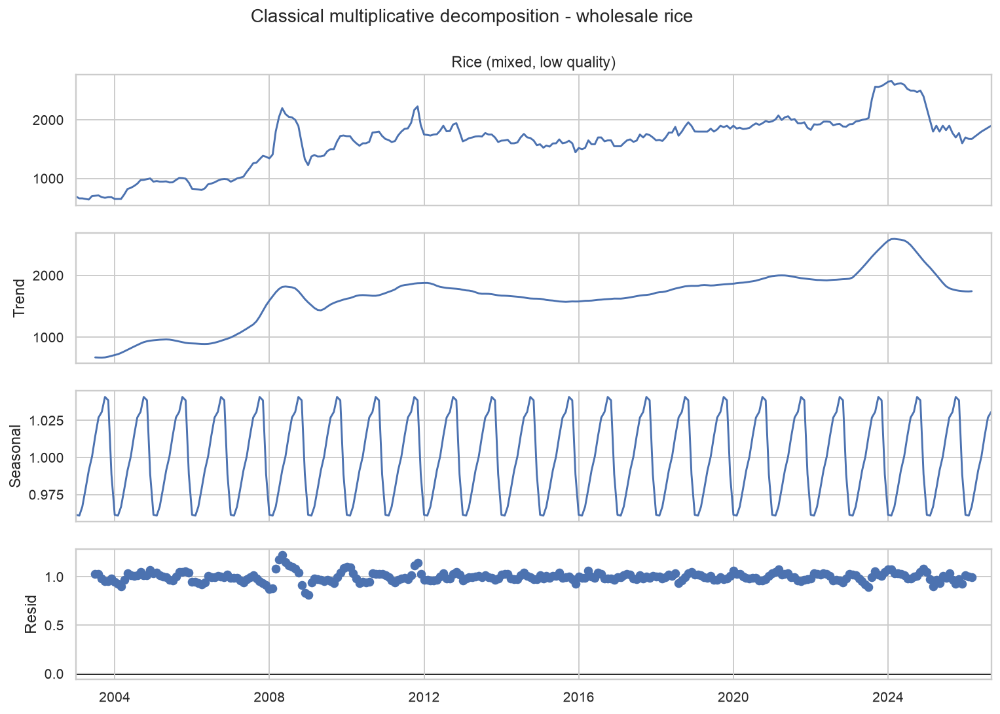

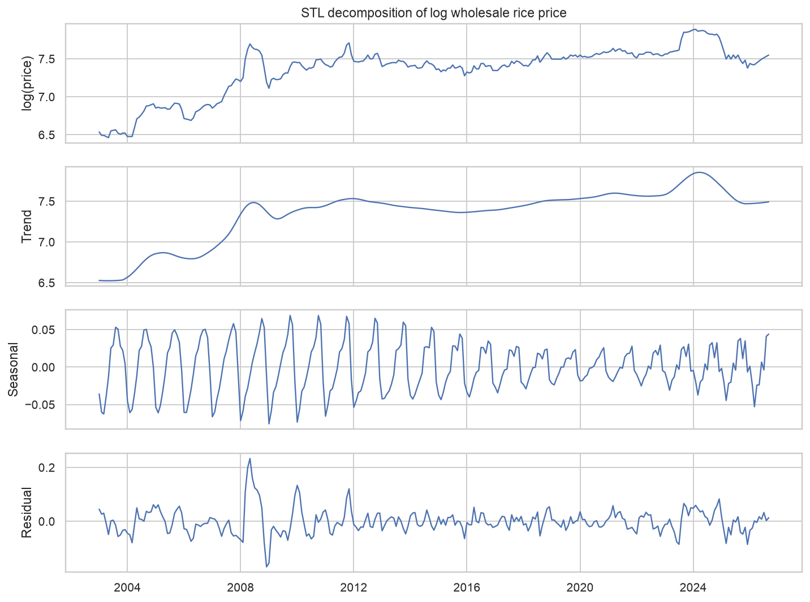

*STL (Seasonal-Trend decomposition using LOESS) goes beyond the course. Unlike the classical method, it lets the seasonal pattern change over time.*

* **Trend strength = 0.98** (very strong). **Seasonal strength = 0.35** (weak to moderate). Formula: \(F = \max(0, 1 - \mathrm{Var}(R)/\mathrm{Var}(X+R))\), where \(R\) is the residual and \(X\) is the trend or seasonal component.
* The seasonal swing was **larger before 2012** (±6%) and is **smaller recently** (±3%). This is likely because better roads, storage and milling have smoothed harvest effects.
* The residuals are mostly small, but they **spike in 2008–2009 and 2023–2025**. These periods are the unpredictable shocks.

### 3.5 Seasonal plot

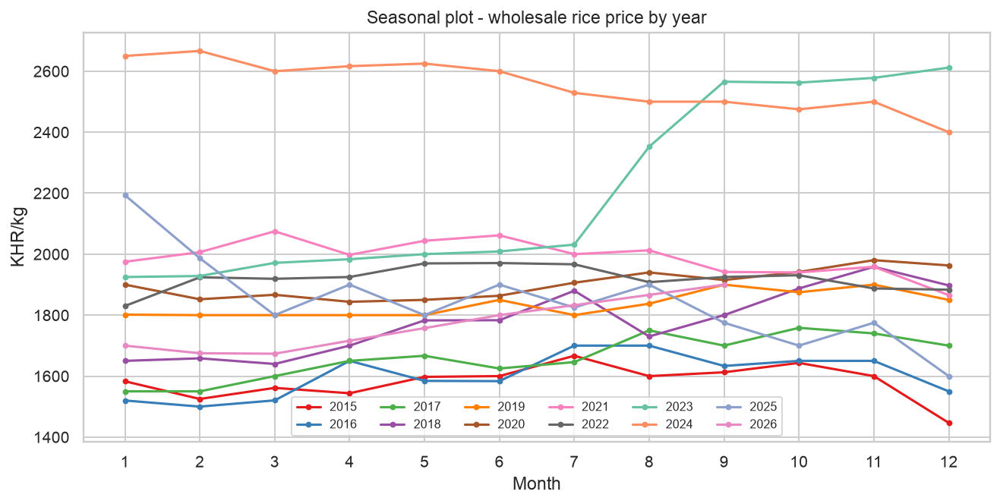

Each line is one year. Most years rise from the first half to Aug–Nov and dip in December. But **the level difference between years (e.g., 2024 vs 2025) is much larger than the within-year seasonal swing**. In practice, the trend and shocks dominate the forecast; seasonality adds only fine detail.

### 3.6 Scatterplots and correlation (EP2)

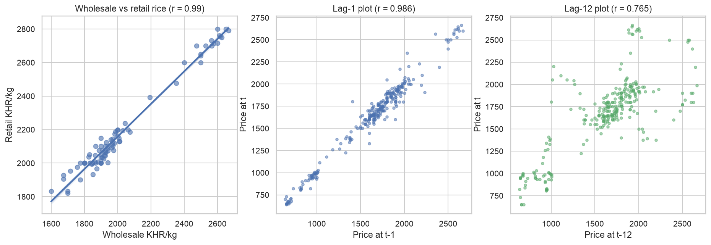

* **Wholesale vs retail rice: r = 0.99.** The retail price is about 8% above wholesale on average, so a wholesale forecast also works as a retail forecast.
* **Lag-1 plot: r = 0.986.** This month's price is almost the same as last month's, which is strong positive autocorrelation.
* **Lag-12 plot: r = 0.77.** Same month last year is less informative than last month, which is why seasonal naive will perform poorly.
* *Correlation ≠ causation* (EP2): wholesale and retail move together because both respond to the same paddy supply.

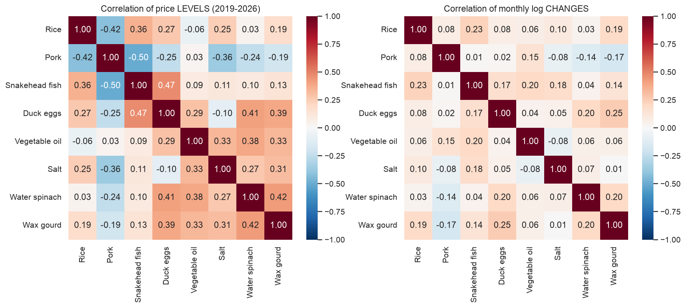

* **Levels (left):** some commodities look strongly correlated (e.g., vegetable oil vs pork), but mainly because both trend over time. Correlating two trending series is a classic **spurious correlation**.
* **Monthly changes (right):** correlations are almost all near 0 (|r| < 0.25). **Each food has its own price drivers** (livestock cycles, fish seasons, vegetable weather, global oil markets), so we model each commodity separately.

---

## 4. Stationarity, differencing and random walk (EP4)

### 4.1 Differencing

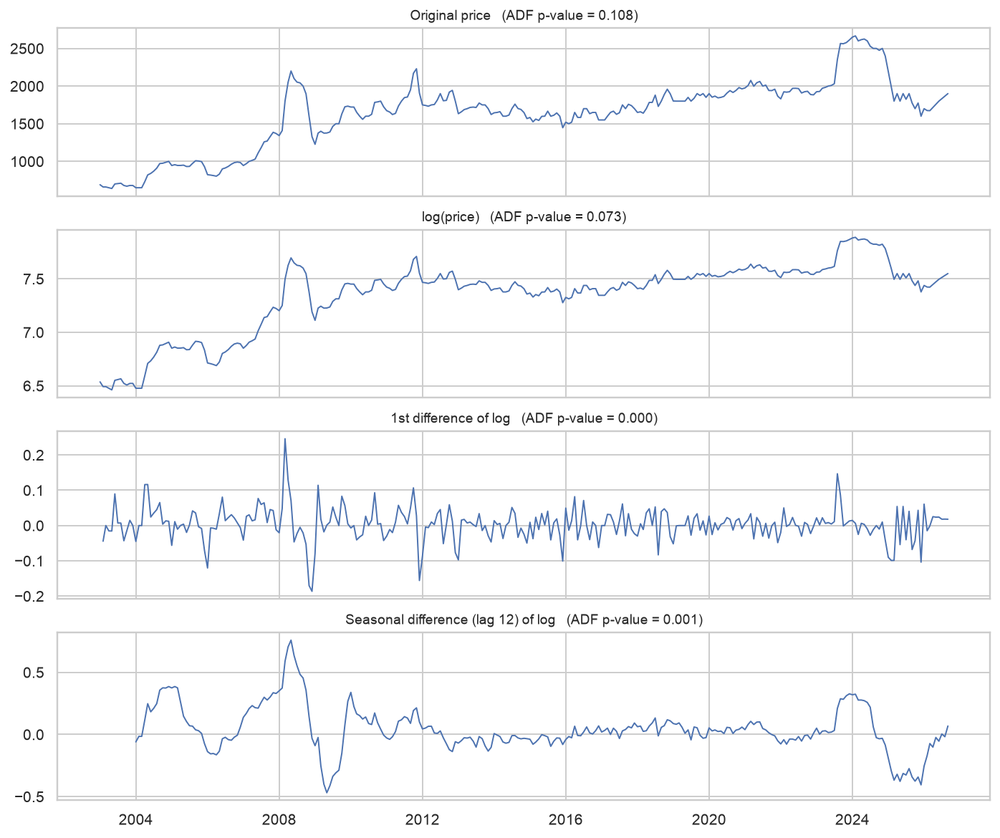

We transformed the series step by step:

* **log(price):** makes changes proportional, so +100 KHR when the price is 700 counts more than +100 when it is 2,500.
* **First difference of log:** approximately the monthly % change, \(y'_t = \log y_t - \log y_{t-1}\).
* **Seasonal difference:** \(y'_t = \log y_t - \log y_{t-12}\).

### 4.2 ADF test (plus KPSS, beyond the course)

ADF: \(H_0\) = non-stationary; reject if p < 0.05.
KPSS (extra): the opposite hypothesis, \(H_0\) = stationary. Using both gives a stronger conclusion.

| Series | ADF p-value | ADF verdict | KPSS p-value | KPSS verdict |
|---|---|---|---|---|
| Original price | 0.108 | non-stationary | 0.01 | non-stationary |
| log(price) | 0.073 | non-stationary | 0.01 | non-stationary |
| **1st difference of log** | **< 0.001** | **stationary** | 0.10 | **stationary** |
| Seasonal difference (lag 12) | 0.0009 | stationary | 0.09 | stationary |
| 1st + seasonal difference | < 0.001 | stationary | 0.10 | stationary |

**Conclusion:** both tests agree. The price **level is non-stationary**, and **one first difference makes it stationary**, so the series is integrated of order 1 (**d = 1** in ARIMA).

### 4.3 ACF and PACF

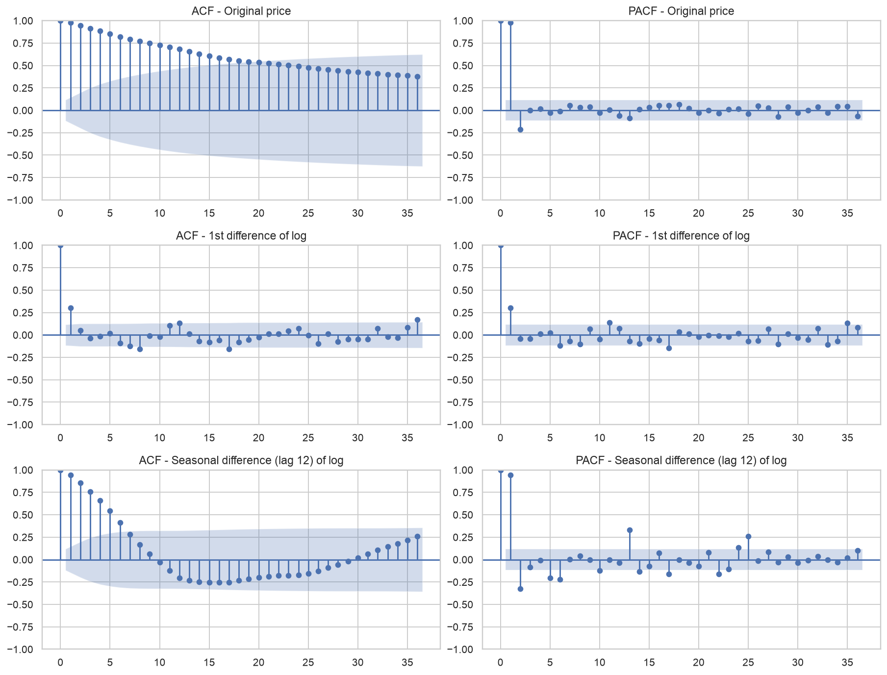

* **Original price:** the ACF decays very slowly (still 0.4 at lag 36). This is the textbook signature of a **trend / non-stationary** series (EP2: "slow decay → long-term persistence or trend").
* **First difference:** only **lag 1 is clearly significant (≈ 0.30)**; other lags are small. The PACF also cuts off after lag 1, which points to an **AR(1) model for the changes**, i.e. ARIMA(1,1,0).
* The small bumps at lags 11–12 in the differenced ACF confirm that the seasonality is weak.

### 4.4 Is rice a random walk?

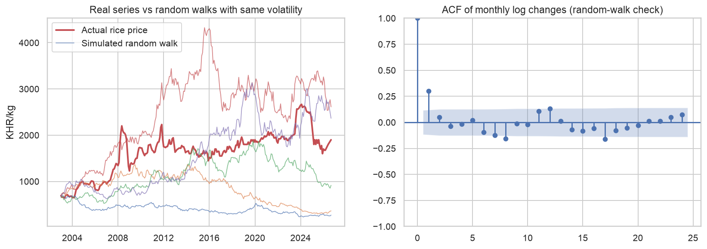

* **Left:** five simulated random walks with the same volatility as rice look just as "trendy" as the real price. As EP4 warns, *a series can look meaningful but still be very difficult to forecast*.
* **Right / Ljung-Box test on monthly changes:** p < 0.001 at lags 1, 3, 6, 12 and 24, so the changes are **not pure white noise**.
* **Verdict:** rice prices are **"random walk with momentum."** The level wanders unpredictably, but a rise this month is followed by a small further rise next month (φ ≈ 0.31). Following the EP4 workflow, the last-value (naive) forecast should be very hard to beat, and the backtest in Section 5.3 shows that it is.

---

## 5. Forecasting models and evaluation (Step 6, EP3)

### 5.1 Models compared

| # | Model | Idea | Source |
|---|---|---|---|
| 1 | Historical mean | future ≈ average of all history | EP3 baseline |
| 2 | Naive (last value) | future ≈ last observation | EP3 baseline / EP4 random walk |
| 3 | Seasonal naive | future ≈ same month last year | EP3 baseline |
| 4 | Drift | last value + average historical slope | beyond |
| 5 | Moving average (3) | mean of last 3 months | EP1 list |
| 6 | ETS – Simple exponential smoothing | weighted average, recent months weigh more | EP1 list ("exponential smoothing") |
| 7 | ETS – Holt damped trend | level + trend that fades out | beyond |
| 8 | ETS – Holt-Winters damped + seasonal | level + trend + 12-month seasonality | beyond |
| 9 | **SARIMA(1,1,0)(0,0,0)₁₂** | AR(1) on monthly log changes; chosen by AIC from 45 candidates | EP1 list ("ARIMA/SARIMA") + EP4 |
| 10 | **Ensemble** | average of Naive + Holt damped + SARIMA | beyond |

ETS and SARIMA are fitted on **log prices** and then back-transformed. This keeps forecasts positive and makes errors proportional.

**SARIMA order selection.** We grid-searched p, q ∈ {0,1,2}, d = 1 and five seasonal options, keeping the lowest AIC (`outputs/06_sarima_grid_top10.csv`).

* The top 8 models are **all non-seasonal**. Adding seasonal terms made AIC worse, which is consistent with the weak seasonal strength found in 3.4.
* Final model: \(\Delta \log y_t = 0.305\,\Delta \log y_{t-1} + \varepsilon_t\), with φ = 0.305 (s.e. 0.043, p < 0.001).

### 5.2 Course-style hold-out test (train ≤ Dec 2025, test Jan–Mar 2026)

The data was split **in time order**, with no shuffling, to avoid look-ahead bias (EP1/EP3). The test months are three consecutive months that were *actually observed*.

| Model | MAE (KHR) | MAPE | Bias |
|---|---|---|---|
| Moving average (3) | **14.4** | **0.86%** | −8.9 |
| Mean | 57.1 | 3.39% | +57.1 |
| Drift | 76.2 | 4.52% | +76.2 |
| Naive / SES | 82.8 | 4.92% | +82.8 |
| Ensemble | 125.8 | 7.48% | +125.8 |
| ETS Holt damped | 146.2 | 8.69% | +146.2 |
| SARIMA(1,1,0) | 148.4 | 8.82% | +148.4 |
| ETS Holt-Winters | 161.8 | 9.61% | +161.8 |
| Seasonal naive | 310.5 | 18.40% | −310.5 |

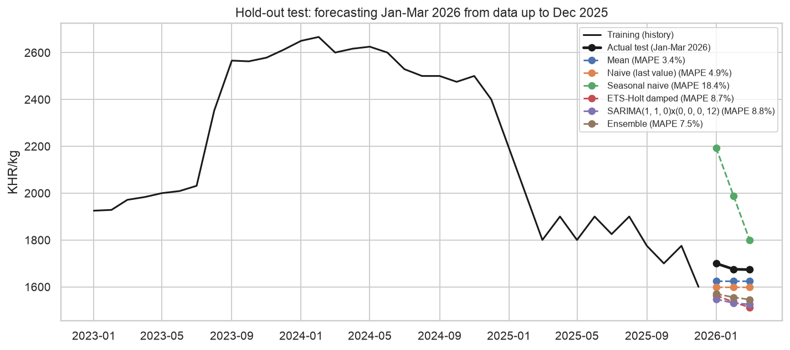

**Interpretation.** December 2025 was an unusually low month (1,600 KHR) that quickly bounced back to ~1,700.

* Models that **anchor on the last value or a trend** (Naive, SARIMA, Holt) followed that dip down and forecast too low. The positive bias means actual > forecast.
* **MA(3)** averaged out the dip and happened to win.
* **Seasonal naive** copied Jan–Mar 2025, when prices were still falling from 2,200, so it was 18% too high.

**Lesson:** a single 3-month test is only **3 data points**, so the winner can be luck. This motivates the more reliable evaluation below.

### 5.3 Rolling-origin backtest (beyond the course)

We **pretended to stand at each month from Sep 2021 to Jun 2026 (58 forecast origins)**. At each origin we refit every model using only past data and forecast 1–3 months ahead. Only real (non-interpolated) months were scored, giving **157 forecasts per model**.

| Model | MAE (KHR) | RMSE | MAPE | MAPE h=1 | MAPE h=2 | MAPE h=3 |
|---|---|---|---|---|---|---|
| **Ensemble** | **79.0** | **125.2** | 3.86% | 2.77% | 3.57% | **5.27%** |
| Naive (last value) | 79.4 | 130.3 | **3.85%** | 2.68% | 3.51% | 5.39% |
| ETS-SES | 79.4 | 130.3 | 3.85% | 2.68% | 3.51% | 5.39% |
| Drift | 80.5 | 130.7 | 3.91% | 2.67% | 3.56% | 5.54% |
| ETS Holt damped | 81.1 | 127.7 | 3.95% | 2.79% | 3.76% | 5.31% |
| SARIMA(1,1,0) | 82.3 | 126.9 | 4.04% | 2.95% | 3.83% | 5.37% |
| ETS Holt-Winters | 99.9 | 141.3 | 4.77% | 3.19% | 4.47% | 6.67% |
| Moving average (3) | 102.4 | 164.4 | 4.90% | 3.45% | 4.78% | 6.48% |
| Seasonal naive | 342.8 | 456.7 | 16.45% | 16.2% | 16.5% | 16.6% |
| Mean | 521.4 | 620.0 | 23.10% | 23.1% | 23.2% | 23.1% |

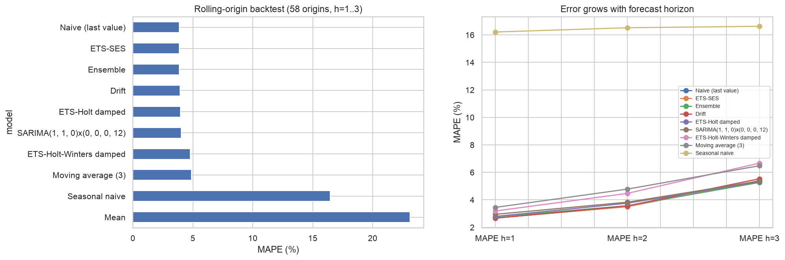

**Interpretation.**

1. **Mean and seasonal naive are far worse** than everything else. Prices have a trend and shocks, so "the long-run average" or "the same month last year" are poor guides (EP3 limitations of the mean forecast).
2. **The naive forecast is extremely hard to beat**, exactly as predicted by the random-walk analysis. Simple exponential smoothing estimated α ≈ 1, which is mathematically the naive forecast.
3. **The ensemble has the lowest MAE and RMSE** and the best 3-month-ahead MAPE, with MAPE tied with naive. Averaging models of different types reduces the risk of one model being badly wrong. This is why we use it for the final forecast.
4. **Error grows with horizon:** about 2.7% one month ahead and about 5.3% three months ahead. For a 1,900 KHR price, that is an expected error of about **±50 KHR next month and ±100 KHR in December**.
5. Holt-Winters (seasonal ETS) is worse than its non-seasonal versions. The ±4% seasonality is **not stable enough** to be worth estimating 12 extra parameters.

### 5.4 Residual diagnostics of the SARIMA model

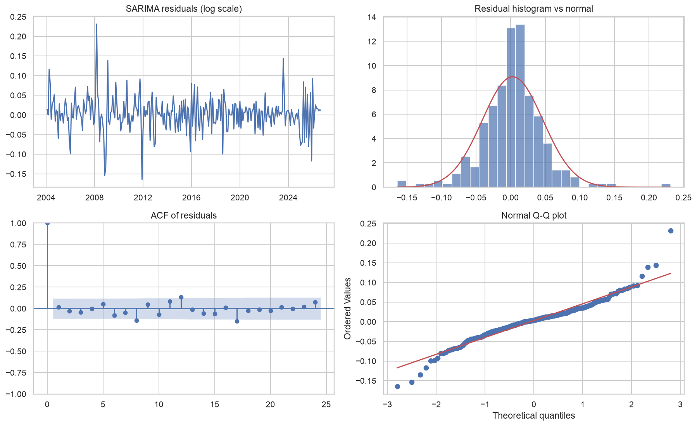

* **Ljung-Box on residuals:** p = 0.77 (lag 6), 0.10 (lag 12), 0.20 (lag 24). **No autocorrelation is left**, so the model has captured all the linear structure (residuals ≈ white noise, EP1).
* **Q-Q plot and Jarque-Bera:** the residuals have fat tails (kurtosis 6.9). Rare large shocks like 2008 and 2023 are bigger than a normal distribution predicts, so the 95% intervals may be **too narrow during crises**.

---

## 6. Final forecast: national (Step 7, data → forecast → decision)

All models were refitted on **all data up to Sep 2026**.

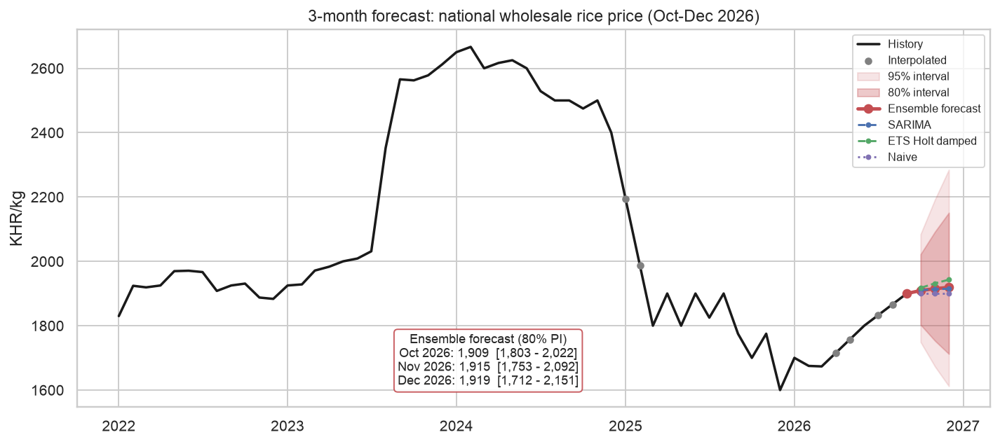

### National wholesale rice (KHR/kg), last observed: Sep 2026 = 1,900

| Month | Ensemble | 80% interval | 95% interval | Naive | Holt damped | SARIMA |
|---|---|---|---|---|---|---|
| Oct 2026 | **1,909** | 1,803 – 2,022 | 1,749 – 2,084 | 1,900 | 1,918 | 1,910 |
| Nov 2026 | **1,915** | 1,753 – 2,092 | 1,673 – 2,192 | 1,900 | 1,932 | 1,914 |
| Dec 2026 | **1,919** | 1,712 – 2,151 | 1,612 – 2,285 | 1,900 | 1,943 | 1,915 |

**Reading the forecast:** prices recovered from 1,600 (Dec 2025) to 1,900 (Sep 2026), and the models carry a little of that momentum forward, about **+1% by December**. The 80% interval says that in 8 out of 10 similar situations the December price would land between **1,710 and 2,150 KHR/kg**.

> **Seasonality caveat:** historically, December prices fall about 1% below the yearly trend as the new harvest arrives (seasonal index), while October–November are seasonal highs. The non-seasonal ensemble does not include this, so a small dip in December is plausible.

### Retail food basket (8 commodities + index)

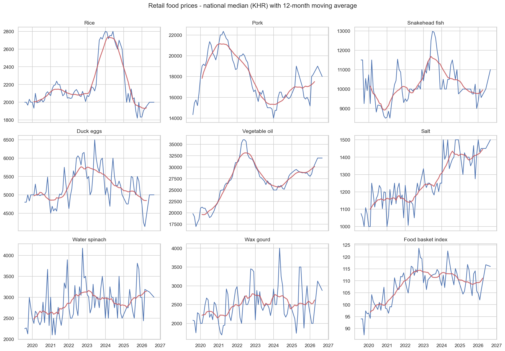

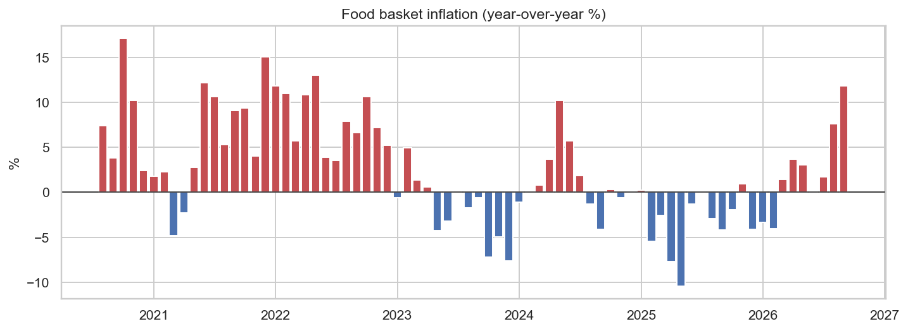

The **food basket index** is the equal-weighted average of the 8 retail prices, with **2020 = 100**.

* Food inflation was high in 2021–2022 (often +10% YoY), negative through most of 2023–2025, and has **turned positive again in 2026 (+11.8% YoY in Sep 2026)**.
* The 2026 rise is driven by pork, vegetable oil, fish and salt.

For each commodity, we ran a rolling backtest (28 origins, Mar 2024 – Jun 2026) and selected the model with the lowest MAPE:

| Commodity (unit) | Best model | Backtest MAPE | Naive MAPE | Sep 2026 | Oct 2026 | Nov 2026 | Dec 2026 | Change to Dec |
|---|---|---|---|---|---|---|---|---|
| Rice (KG) | SARIMA (= random walk) | 4.7% | 4.7% | 2,000 | 2,000 | 2,000 | 2,000 | 0.0% |
| Pork (KG) | ETS Holt-Winters | 4.3% | 5.0% | 18,000 | 17,608 | 17,220 | 17,215 | −4.4% |
| Snakehead fish (KG) | ETS Holt-Winters | 3.3% | 4.0% | 11,000 | 10,296 | 10,357 | 9,753 | −11.3% |
| Duck eggs (10 pcs) | ETS Holt-Winters | 4.4% | 7.6% | 5,000 | 5,269 | 5,211 | 4,906 | −1.9% |
| Vegetable oil (5 L) | Ensemble | 2.2% | 2.3% | 32,000 | 32,012 | 32,022 | 32,031 | +0.1% |
| Salt (KG) | ETS Holt damped | 3.9% | 4.7% | 1,500 | 1,480 | 1,482 | 1,484 | −1.1% |
| Water spinach (KG) | SARIMA(0,1,1) | 9.6% | 13.6% | 3,000 | 3,034 | 3,034 | 3,034 | +1.1% |
| Wax gourd (KG) | ETS Holt-Winters | 17.2% | 24.1% | 2,875 | 3,103 | 3,333 | 3,266 | +13.6% |
| **Food basket index** | Seasonal naive | 3.2% | 5.0% | 116.0 | 112.9 | 114.1 | **105.7** | **−8.9%** |

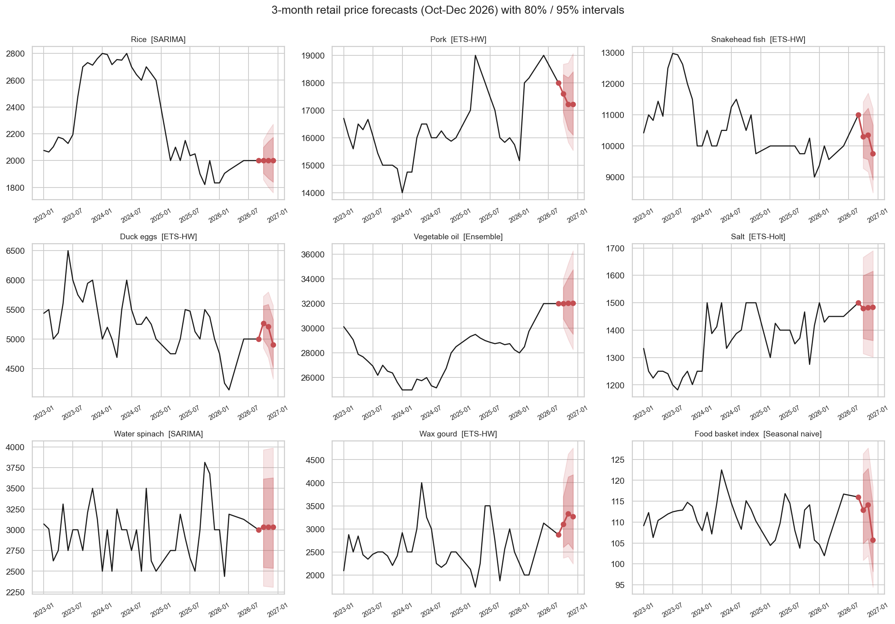

**Interpretation.**

* **Seasonal models win for animal products and vegetables.** Pork, fish, eggs and wax gourd have real yearly cycles: festival demand (Pchum Ben in Sep/Oct, Khmer New Year in April), fish seasons on the Tonle Sap, and the rainy season for vegetables.
* **Snakehead fish is expected to fall ~11% by December.** That matches the Tonle Sap fishing season (Nov–Feb), when supply rises.
* **Rice, vegetable oil and salt are random-walk-like:** best forecast ≈ last value.
* **Vegetables are hard to forecast** (water spinach ~10% and wax gourd ~17% MAPE) because they are perishable and weather-driven, so their prediction intervals are very wide.
* The **basket index is expected to ease back** toward ~106 by December, mostly from fish and pork.

---

## 7. Province-level forecasts (beyond the course: top-down hierarchical forecasting)

Province series have many gaps (some provinces have only 2–3 observations in 2026). Fitting a separate model per province would be unreliable, so we used a **top-down** approach:

1. For each province, compute its **relative price level** = province price ÷ national price. We take the median over the last 12 months, or the last 24 months if there are fewer than 2 observations.
2. **Province forecast = national forecast × relative level.** The intervals are scaled the same way.
3. Provinces with no observation in the last 6 months were excluded (e.g., Tboung Khmum, last seen Dec 2024).

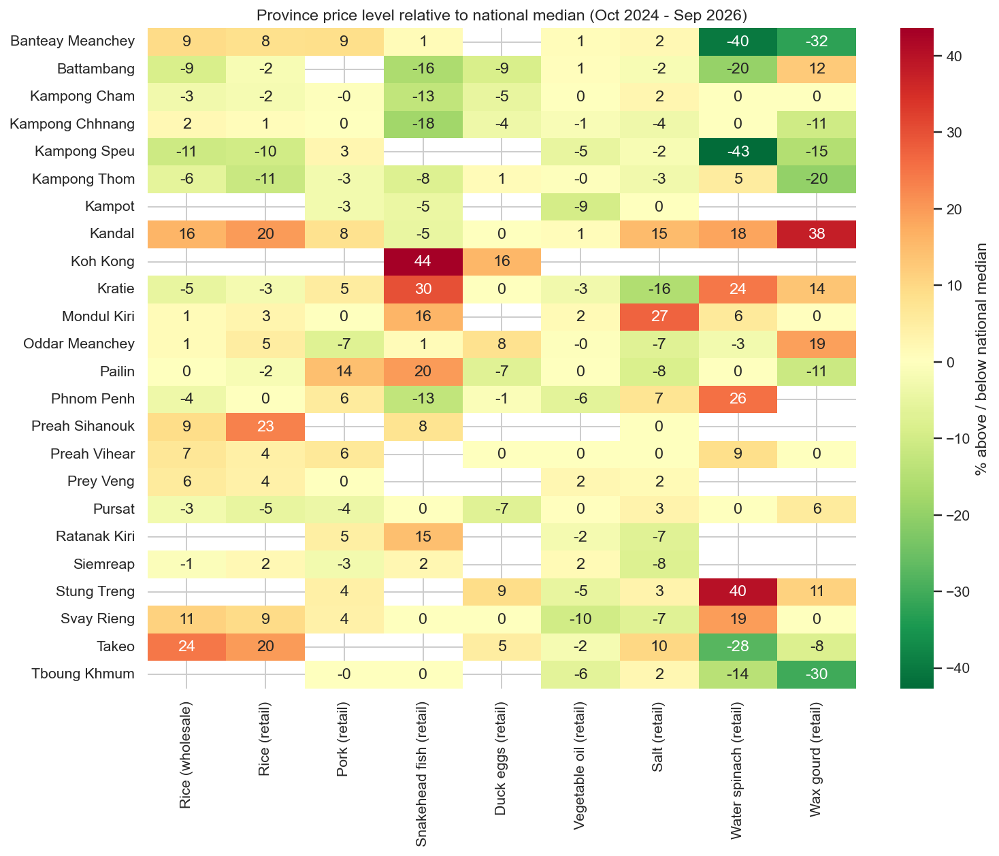

How to read the heatmap: green = cheaper than the national median, red = more expensive.

* **Rice:** cheapest in Battambang and Kampong Speu (−9% to −11%), dearest in Takeo (+24%) and Kandal (+16%).
* **Fish:** much more expensive in Koh Kong, Kratie, Mondul Kiri and Pailin (+15% to +45%), far from the Tonle Sap and Mekong fisheries. Cheapest in Battambang and Kampong Chhnang (−16% to −18%), next to the Tonle Sap lake.
* **Vegetables** vary the most across provinces (−40% to +40%) because they are perishable and sold locally. **Vegetable oil**, a packaged, nationally traded good, is nearly the same everywhere (mostly within ±5%, at most ±10%).
* **Salt** is cheap in most provinces but costs more in the remote north-east (Mondul Kiri +27%) and in Kandal (+15%).

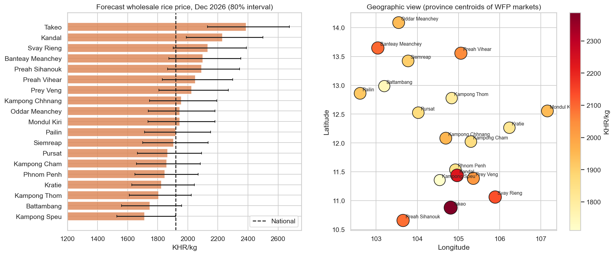

### Wholesale rice forecast by province, December 2026 (KHR/kg)

| Province | Relative level | Last observed | Dec 2026 forecast | 80% interval |
|---|---|---|---|---|
| Kampong Speu | 0.89 | 1,700 | 1,712 | 1,527 – 1,918 |
| Battambang | 0.91 | 1,700 | 1,748 | 1,560 – 1,959 |
| Kampong Thom | 0.94 | 1,900 | 1,806 | 1,611 – 2,024 |
| Kratie | 0.95 | 1,800 | 1,824 | 1,628 – 2,044 |
| Phnom Penh | 0.96 | 1,650 | 1,846 | 1,647 – 2,069 |
| Kampong Cham | 0.97 | 1,817 | 1,859 | 1,658 – 2,083 |
| Pursat | 0.97 | 1,800 | 1,866 | 1,665 – 2,092 |
| Siemreap | 0.99 | 2,000 | 1,906 | 1,700 – 2,136 |
| Pailin | 1.00 | 1,800 | 1,919 | 1,712 – 2,151 |
| Mondul Kiri | 1.01 | 1,900 | 1,946 | 1,736 – 2,181 |
| Oddar Meanchey | 1.01 | 2,000 | 1,946 | 1,736 – 2,181 |
| Kampong Chhnang | 1.02 | 2,042 | 1,957 | 1,746 – 2,193 |
| Prey Veng | 1.06 | 1,900 | 2,026 | 1,807 – 2,270 |
| Preah Vihear | 1.07 | 1,850 | 2,051 | 1,830 – 2,298 |
| Preah Sihanouk | 1.09 | 1,925 | 2,092 | 1,866 – 2,344 |
| Banteay Meanchey | 1.09 | 1,950 | 2,100 | 1,873 – 2,353 |
| Svay Rieng | 1.11 | 2,000 | 2,132 | 1,903 – 2,390 |
| Kandal | 1.16 | 2,200 | 2,231 | 1,990 – 2,500 |
| Takeo | 1.24 | 2,300 | 2,388 | 2,130 – 2,676 |

The full province × commodity × month table, with 80% and 95% intervals for all 9 series, is in `outputs/13_province_forecasts.csv`.

---

## 8. Decisions and recommendations (Step 7–8)

1. **Cash-transfer budgeting (WFP / NGOs):** no large rice price change is expected through December, so the current rice component of transfers can be kept. Use the **upper 80% bound (~2,150 KHR/kg nationally, ~2,400–2,700 in Takeo/Kandal)** as a safety margin.
2. **Protein is the relief:** fish and pork prices are expected to fall into the harvest and fishing season, so the overall basket should ease about 9% from September's high.
3. **Watch-list:** vegetable oil is at a multi-year high (32,000 KHR / 5 L) and forecast to stay there. It is import-dependent, so it is exposed to world prices and the exchange rate.
4. **Province targeting:** south-eastern provinces (Takeo, Kandal, Svay Rieng) pay 10–25% more for rice, and remote provinces pay 15–45% more for fish. Assistance values could be differentiated by province.
5. **Deployment (Step 8–10):** `analysis.py` reruns end to end in about 25 seconds. When WFP publishes October data, rerun the script to update the forecasts, and compare forecast vs actual each month to monitor the model.

---

## 9. Limitations

* **Missing months:** 6 of the last 21 months are interpolated, including Apr–May and Jul–Aug 2026. The recent up-trend is drawn from only three real points (Mar, Jun, Sep 2026), so the momentum could be overstated.
* **Changing sample:** the provinces and markets reporting each month vary. The median reduces but does not remove this effect.
* **Univariate models only:** the models use past prices only. They cannot foresee policy shocks (export bans), floods/droughts, exchange-rate moves or global oil prices. These caused the largest errors in history (2008, 2023), and, as EP1 Step 9 says, *historical patterns cannot perfectly predict unexpected events.*
* **Fat-tailed shocks:** intervals assume roughly normal errors on the log scale, but residuals have kurtosis ≈ 7, so true crisis risk is higher than the 95% band suggests.
* **Ensemble intervals** are an average of the members' bounds on the log scale. This is a practical approximation, not an exact interval.
* **Top-down province forecasts** assume each province keeps its recent relative price level.

## 10. Possible extensions

* Add external drivers (SARIMAX): world rice price (FAO), fuel price, rainfall, USD/KHR exchange rate.
* Machine-learning models with lag features (e.g., gradient boosting) across all provinces at once.
* Hierarchical reconciliation (MinT) so province forecasts add up consistently to the national forecast.

---

## Appendix A: Where each course topic is applied

| Course topic | Section / Figure |
|---|---|
| EP1: time-series definition, equally spaced data | §2 (monthly, interpolated gaps) |
| EP1: trend, seasonality, residuals (decomposition) | §3.4, Fig 06–07 |
| EP1: 10-step forecasting process | §1 (goal, target, horizon), §2 (data), §3 (explore), §5 (model and evaluate), §6 (decision), §8 (deploy, monitor, update) |
| EP1: no random shuffling, look-ahead bias | §5.2, §5.3 |
| EP2: mean, median, mode | §3.2 table, Fig 03 |
| EP2: histogram (center, spread, skew, peaks) | Fig 03 |
| EP2: boxplot by month / group, IQR, outliers | Fig 04–05 |
| EP2: scatterplot, correlation ≠ causation | Fig 09–10 |
| EP2: autocorrelation plot | Fig 09 (lag plots), Fig 12 |
| EP3: forecast horizon, multi-step forecast | §1, h = 3 |
| EP3: train/test split | §5.2, Fig 14 |
| EP3: mean, last-value, seasonal-naive baselines | §5.1–5.3 |
| EP3: forecast error, MAE, MAPE | §5.2–5.3 tables |
| EP3: metrics + visualization | Fig 14–15, 17, 20 |
| EP4: stationarity, differencing (first and seasonal) | §4.1, Fig 11 |
| EP4: ADF test and decision rule | §4.2 table |
| EP4: random walk and its identification workflow | §4.4, Fig 13 |
| EP4: ACF / lag relationships | §4.3, Fig 12 |

**Beyond the course:** KPSS test, PACF, STL decomposition with trend/seasonal strength, Ljung-Box test, log transform, exponential smoothing (SES / Holt damped / Holt-Winters), SARIMA with AIC grid search, residual diagnostics (Q-Q, Jarque-Bera), ensemble forecasting, rolling-origin cross-validation, prediction intervals, RMSE and bias metrics, food-basket price index and YoY inflation, top-down hierarchical province forecasts, geographic visualisation.

## Appendix B: Reproducing the results

```bash
cd final_project
pip install pandas numpy matplotlib seaborn scipy statsmodels
python3 analysis.py
```

Output tables in `outputs/`:

| File | Content |
|---|---|
| `01_rice_wholesale_national.csv` | National series with the imputed-month flag |
| `04_stationarity_tests.csv` | ADF and KPSS results |
| `07_holdout_scores.csv`, `08_backtest_scores.csv`, `08_backtest_mape_by_horizon.csv` | Model evaluation |
| `10_rice_wholesale_forecast.csv` | National rice forecast with 80% / 95% intervals |
| `12_basket_forecast_summary.csv`, `12_basket_forecast_intervals.csv` | Retail commodity forecasts |
| `13_province_forecasts.csv` | Province × commodity × month forecasts |
| `09_sarima_summary.txt` | Full SARIMA model output |
